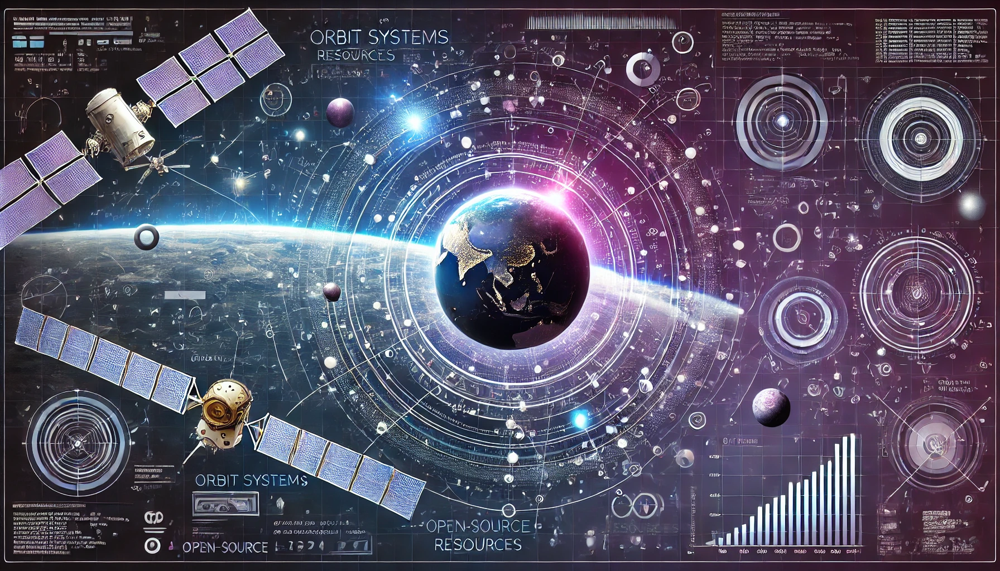

  

<h1 align="center">🛰️ Space Systems Engineering Resources</h1>

  A curated, beginner-to-expert list of <b>free and open-source</b> resources for space mission design, 
  spacecraft engineering, orbit design, tracking, courses, software and data.

  <a href="#-start-here">Start here</a> ·
  <a href="#-orbit-designers">Orbit designers</a> ·
  <a href="#-learn">Learn</a> ·
  <a href="#-software--tools">Software</a> ·
  <a href="#-data--references">Data</a> ·
  <a href="#-stay-current">Stay current</a> ·
  <a href="#-contributing">Contribute</a>

---

## How to read this list

Every entry has two quick tags, so you can tell at a glance what you are clicking on.

| Level | | Format | |
|:--|:--|:--|:--|
| 🟢 | Beginner, no background needed | 🌐 | Runs in the browser, nothing to install |
| 🟡 | Intermediate, some maths or engineering | 💻 | Desktop application |
| 🔴 | Advanced, professional or graduate level | 🐍 | Python library / code |
| | | 📄 | Document, handbook or standard |
| | | 🎥 | Video or video series |
| | | 💰 | Paid, or free tier of a paid product |

---

## 🚀 Start here

New to space, orbits or engineering? Do these in order and you will have a solid mental model in an afternoon.

1. 🎥 **[Basic Orbit Shapes](https://youtu.be/pRvVK2m_wGE?si=6pnQ8IVz3JazXULe)** — orbits explained in plain English
2. 🌐 **[orbitalmechanics.info](https://orbitalmechanics.info/)** — play with altitude, inclination and eccentricity and see what changes
3. 🌐 **[groundtracks](https://groundtracks.com/)** — design your first satellite in the browser and see where it flies over Earth
4. 🌐 **[LeoLabs](https://platform.leolabs.space/visualization)** or **[KeepTrack](https://app.keeptrack.space/)** — see every tracked satellite and piece of debris in real time
5. 📄 **[NASA Basics of Space Flight](https://science.nasa.gov/learn/basics-of-space-flight/)** — JPL's classic free primer on the space environment, orbits and spacecraft
6. 🎥 **[Gentry Lee — Systems Engineering When the Canvas Is Blank](https://youtu.be/3S5cgLxxZ14?si=g9-W5WY7kisidHbn)** — how satellites get designed from nothing
7. 📬 **[Sign up for a few newsletters](#newsletters)** to slowly soak up how the industry works

---

## Contents

- [🧭 Orbit Designers](#-orbit-designers)
- [🌍 Orbit Visualisers](#-orbit-visualisers)
- [📡 Space Object Trackers](#-space-object-trackers)
- [🎓 Learn](#-learn)
  - [Orbital Mechanics](#orbital-mechanics) · [Space Environment](#space-environment) · [Systems Engineering](#systems-engineering) · [Spacecraft Subsystems](#spacecraft-subsystems) · [Mission Design](#mission-design) · [Structured Courses](#structured-courses)
- [🔧 Software & Tools](#-software--tools)
  - [Astrodynamics Libraries](#astrodynamics-libraries) · [Spacecraft Simulation](#spacecraft-simulation) · [Flight Software](#flight-software) · [Ground Segment & Mission Control](#ground-segment--mission-control) · [Systems Modelling (MBSE)](#systems-modelling-mbse) · [CAD & Structural](#cad--structural)
- [📚 Data & References](#-data--references)
  - [Datasets](#datasets) · [Standards & Handbooks](#standards--handbooks)
- [🎯 Focus Areas](#-focus-areas)
  - [CubeSats](#cubesats) · [Moon & Lunar Surface](#moon--lunar-surface) · [Space Debris & Sustainability](#space-debris--sustainability)
- [📰 Stay Current](#-stay-current)
  - [News](#news) · [Newsletters](#newsletters) · [Articles & Deep Dives](#articles--deep-dives) · [Communities](#communities)
- [📋 Other Master Lists](#-other-master-lists)
- [🤝 Contributing](#-contributing)

---

## 🧭 Orbit Designers

Tools where you *design* an orbit or mission, rather than just look at one: pick orbits, plan manoeuvres, and check coverage, access, eclipses and lifetime.

| Tool | What it's for | Format | Level |
|:--|:--|:--:|:--:|
| **[groundtracks](https://groundtracks.com/)** | Browser-based satellite mission designer. Single satellites or Walker constellations with SGP4 propagation, plus access, coverage, link-budget, eclipse and orbital-decay analysis. Free, no install. | 🌐 | 🟢 |
| **[GMAT — download from NASA](https://software.nasa.gov/software/GSC-19640-1)** | NASA's General Mission Analysis Tool. Open-source trajectory design, optimisation and navigation, from LEO to interplanetary. Older builds and source are on [SourceForge](https://sourceforge.net/projects/gmat/files/GMAT/); docs and tutorials on the [GMAT Wiki](https://gmat.atlassian.net/wiki/spaces/GW). | 💻 | 🟡 |
| **[NASA Trajectory Browser](https://trajbrowser.arc.nasa.gov/)** | Search ready-made trajectories to planets, moons and asteroids, with porkchop plots of launch windows. | 🌐 | 🟡 |
| **[JPL Horizons](https://ssd.jpl.nasa.gov/horizons/)** | Precise ephemerides (positions and velocities) for almost any solar system body or spacecraft. | 🌐 | 🟡 |
| **[Ansys STK](https://www.ansys.com/products/missions/ansys-stk)** | Industry-standard mission analysis suite; a free personal-use licence is available. | 💻 💰 | 🟡 |
| **[EMTG (NASA)](https://github.com/nasa/EMTG)** | Evolutionary Mission Trajectory Generator: global optimisation of interplanetary missions, including low-thrust. | 💻 | 🔴 |
| **[pykep (ESA)](https://esa.github.io/pykep/)** | ESA's scientific library for interplanetary trajectory design and optimisation. | 🐍 | 🔴 |
| **[Tudat (TU Delft)](https://docs.tudat.space/)** | TU Delft Astrodynamics Toolbox, used in Python as `tudatpy`. Propagation, estimation and optimisation. | 🐍 | 🔴 |

---

## 🌍 Orbit Visualisers

See orbits and the solar system in 3D.

| Tool | What it's for | Format | Level |
|:--|:--|:--:|:--:|
| **[orbitalmechanics.info](https://orbitalmechanics.info/)** | Interactive orbit-shape visualiser (inclination, eccentricity, altitude). | 🌐 | 🟢 |
| **[Stuff in Space](https://stuffin.space/)** | Real-time 3D view of objects in Earth orbit. | 🌐 | 🟢 |
| **[NASA Eyes on the Solar System](https://eyes.nasa.gov/)** | Real-time 3D exploration of the solar system and NASA missions. | 🌐 | 🟢 |
| **[Celestia](https://celestia.space/)** | Free, open-source real-time 3D space simulation. | 💻 | 🟢 |
| **[OpenSpace](https://www.openspaceproject.com/)** | Open-source interactive astrophysics visualisation used in planetariums. | 💻 | 🟡 |

---

## 📡 Space Object Trackers

Where is that satellite right now, and when will it pass over me?

| Tool | What it's for | Format | Level |
|:--|:--|:--:|:--:|
| **[LeoLabs Visualiser](https://platform.leolabs.space/visualization)** | Commercial-grade tracking of LEO objects and debris. | 🌐 | 🟢 |
| **[KeepTrack](https://app.keeptrack.space/)** | Open-source satellite tracking and space situational awareness. | 🌐 | 🟢 |
| **[SatelliteTracker3D](https://satellitetracker3d.com/)** | 3D globe of active satellites. | 🌐 | 🟢 |
| **[Heavens-Above](https://www.heavens-above.com/)** | Pass predictions for the ISS and other satellites from your location. | 🌐 | 🟢 |
| **[N2YO](https://www.n2yo.com/)** | Live tracking and pass predictions for any ground location. | 🌐 | 🟢 |
| **[OrbTrack](https://www.orbtrack.org/)** | Track any satellite from TLE data. | 🌐 | 🟢 |
| **ISS trackers** | [AstroViewer](https://www.astroviewer.net/iss/en/) · [ISSTracker](https://isstracker.pl/en) | 🌐 | 🟢 |
| **[Gpredict](http://gpredict.oz9aec.net/)** | Desktop tracking and prediction; drives radios and antenna rotators. | 💻 | 🟡 |
| **[CelesTrak](https://celestrak.org/)** | The trusted source for TLEs, satellite catalogue and [SOCRATES](https://celestrak.org/SOCRATES/) conjunction reports. | 🌐 | 🟡 |
| **[Space-Track.org](https://www.space-track.org/)** | Official US catalogue of all tracked space objects (free account). | 🌐 | 🟡 |

---

## 🎓 Learn

### Orbital Mechanics
- 🟢 🎥 [Basic Orbit Shapes](https://youtu.be/pRvVK2m_wGE?si=6pnQ8IVz3JazXULe) — best starting point
- 🟢 🎥 [Orbital Mechanics in plain English — Nick Morgan](https://youtu.be/tJiAkBxuqfs?si=x1ahbnxIJg1Faupv)
- 🟢 🎥 [Orbit Types — NSSI](https://youtu.be/BvjlBpP4zU8?si=3GGbxjtBLVI0Obvu) — LEO, MEO, GEO and HEO explained
- 🟡 🎥 [Geometry of Parabolic and Hyperbolic Orbits](https://youtu.be/1-qehYJPUug?si=58UHMKfcntBF8Tro)
- 🟡 🎥 [Orbital Mechanics with Python — playlist](https://youtube.com/playlist?list=PLOIRBaljOV8gn074rWFWYP1dCr2dJqWab&si=cxbmqzfNNqwVozZL) — full series, with code in the [AWP repo](https://github.com/alfonsogonzalez/AWP)
- 🟡 🎥 [Rocket Trajectory Optimisation — RocketPy playlist](https://youtube.com/playlist?list=PLgcFtfzOxjA5CXDdKx6C8OQ_1ZsLLqwZW) — simulation and trajectory planning
- 🔴 📄 [MIT OCW 16.346 — Astrodynamics](https://ocw.mit.edu/courses/16-346-astrodynamics-fall-2008/) — graduate lectures and notes

### Space Environment
- 🟢 🎥 [Space Environment — NSSI](https://youtu.be/LIqPxnoprqY?si=wCd0R8S3H1LmbyYf) — radiation, plasma, thermal vacuum
- 🟢 🌐 [NOAA Space Weather Prediction Center](https://www.swpc.noaa.gov/) — live solar and geomagnetic activity
- 🔴 🌐 [SPENVIS (ESA)](https://www.spenvis.oma.be/) — model the radiation environment for your orbit

### Systems Engineering
- 🟢 🎥 Gentry Lee on systems engineering: [So You Want to Be a Systems Engineer?](https://youtu.be/E6U_Ap2bDaE?si=HCgxD6N37XB2XAyF) · [When the Canvas Is Blank](https://youtu.be/3S5cgLxxZ14?si=g9-W5WY7kisidHbn)
- 🟢 🎥 [Common Definitions of Systems Engineering — NASA](https://youtu.be/rrBg-hTUM_Q?si=wnZTzlQ5YlFFIs2e)
- 🟢 🎥 [Build a CubeSat — YouTube channel](https://youtube.com/@buildacubesat?si=3oTdnVCkyS1UhjHu) — end-to-end CubeSat design
- 🟡 📄 [NASA Systems Engineering Handbook](https://www.nasa.gov/reference/systems-engineering-handbook/) — the definitive reference, free
- 🔴 📄 [MIT OCW 16.89J — Space Systems Engineering](https://ocw.mit.edu/courses/16-89j-space-systems-engineering-spring-2007/) — full lecture notes and assignments

### Spacecraft Subsystems

| Subsystem | Resources |
|:--|:--|
| **Overview** | 🟡 📄 [NASA Small Spacecraft State-of-the-Art Report](https://www.nasa.gov/smallsat-institute/sst-soa/) — every subsystem, with real flight hardware |
| **Attitude (ADCS / GNC)** | 🟡 🎥 [Spacecraft Attitude Dynamics intro](https://youtu.be/oa_E2V8bFpI) · 🟡 📄 [NASA SOA: Guidance, Navigation & Control](https://www.nasa.gov/smallsat-institute/sst-soa/guidance-navigation-and-control/) |
| **Propulsion** | 🟢 🎥 [Rocket propulsion in plain English](https://youtu.be/7DB7-yOPkO8) · 🟢 📄 [What is electric propulsion? (ESA)](https://www.esa.int/Enabling_Support/Space_Engineering_Technology/What_is_Electric_propulsion) |
| **Power** | 🟢 🎥 [Spacecraft Power Systems — NSSI](https://youtu.be/8TUxNEbXOaQ) — solar arrays, batteries, power budgets |
| **Thermal** | 🟢 📄 [Thermal control (ESA)](https://www.esa.int/Enabling_Support/Space_Engineering_Technology/Thermal_control) · 🔴 📄 [NASA TFAWS](https://tfaws.nasa.gov/) — Thermal & Fluids Analysis Workshop materials |
| **Communications** | 🟢 🎥 [Link Budget Basics](https://youtu.be/Z-h4NkBpHJI) · 🟡 📄 [Link budget worked examples (UNOOSA KiboCUBE)](https://www.unoosa.org/documents/pdf/Access2Space4All/KiboCUBE/KiboCUBEAcademy/Online202212/KiboCUBE_Academy_2022_Live-Session2-2.pdf) · 🟢 📄 [AMSAT education](https://www.amsat.org/education/) |

### Mission Design
- 🟢 🎥 [NASA Mission Design Introduction](https://youtu.be/xRkKo_yM-Ps) — trade studies and concept of operations
- 🟡 📄 [GMAT Wiki & tutorials](https://gmat.atlassian.net/wiki/spaces/GW) — step-by-step sample missions for [GMAT](#-orbit-designers)
- 🟡 📄 [Fundamentals of Astrodynamics (Bate, Mueller, White)](https://www.amazon.com/Fundamentals-Astrodynamics-Roger-Bate/dp/0486600610) 💰 — classic, very affordable textbook

### Structured Courses
- 🟡 [Spacecraft Dynamics & Control — Coursera (CU Boulder)](https://www.coursera.org/specializations/spacecraft-dynamics-control) — Hanspeter Schaub's attitude dynamics specialisation; free to audit
- 🟡 [ESA Academy](https://www.esa.int/Education/ESA_Academy) — training courses and hands-on programmes for university students in ESA member states

---

## 🔧 Software & Tools

> Orbit and mission design tools such as GMAT, STK and pykep are in **[🧭 Orbit Designers](#-orbit-designers)**.

### Astrodynamics Libraries

| Tool | What it's for | Format | Level |
|:--|:--|:--:|:--:|
| **[Skyfield](https://rhodesmill.org/skyfield/)** | Easy, accurate positions of satellites, planets and stars in Python. | 🐍 | 🟢 |
| **[AWP](https://github.com/alfonsogonzalez/AWP)** | Astrodynamics with Python: worked orbital mechanics examples. | 🐍 | 🟢 |
| **[Poliastro](https://github.com/poliastro/poliastro)** | Pure-Python astrodynamics for quick orbit analysis *(archived, still useful for learning)*. | 🐍 | 🟡 |
| **[Orekit](https://www.orekit.org/)** | Robust Java astrodynamics library backed by CNES; Python wrapper available. | 📦 | 🔴 |
| **[open-space-toolkit](https://github.com/open-space-collective/open-space-toolkit)** | C++/Python libraries for orbits, frames and physics. | 🐍 | 🔴 |
| **[SPICE Toolkit (NASA NAIF)](https://naif.jpl.nasa.gov/naif/toolkit.html)** | The standard for spacecraft geometry and ephemerides, used by almost every planetary mission. | 📦 | 🔴 |
| **[RocketPy](https://github.com/RocketPy-Team/RocketPy)** | 6-DOF rocket trajectory simulator. | 🐍 | 🟡 |

### Spacecraft Simulation

| Tool | What it's for | Format | Level |
|:--|:--|:--:|:--:|
| **[Basilisk](https://hanspeterschaub.info/basilisk/)** | Modular spacecraft simulation framework from CU Boulder; strong on ADCS. | 🐍 | 🔴 |
| **[42 (NASA)](https://software.nasa.gov/software/GSC-16720-1)** | Multi-body spacecraft attitude and orbit simulation. | 💻 | 🔴 |

### Flight Software

| Tool | What it's for | Format | Level |
|:--|:--|:--:|:--:|
| **[NASA core Flight System (cFS)](https://cfs.gsfc.nasa.gov/)** | Reusable flight software framework flown on many NASA missions. | 📦 | 🔴 |
| **[F´ (F Prime, JPL)](https://fprime.jpl.nasa.gov/)** | JPL's flight software framework for small spacecraft and instruments; flew on the Mars helicopter. | 📦 | 🔴 |

### Ground Segment & Mission Control

| Tool | What it's for | Format | Level |
|:--|:--|:--:|:--:|
| **[SatNOGS](https://satnogs.org/)** | Open global network of ground stations; download data from many CubeSats. | 🌐 | 🟢 |
| **[Open MCT (NASA)](https://nasa.github.io/openmct/)** | Web-based mission control and telemetry visualisation framework. | 🌐 | 🟡 |
| **[GNU Radio](https://www.gnuradio.org/)** | Open-source signal-processing toolkit, widely used for satellite radio. | 💻 | 🟡 |
| **[gr-satellites](https://github.com/daniestevez/gr-satellites)** | GNU Radio decoders for satellite telemetry. | 💻 | 🟡 |
| **[Yamcs](https://yamcs.org/)** | Open-source mission control system for telemetry and commanding. | 💻 | 🔴 |
| **[OpenC3 COSMOS](https://openc3.com/)** | Open-source command and control for spacecraft and test benches. | 💻 | 🔴 |

### Systems Modelling (MBSE)

| Tool | What it's for | Format | Level |
|:--|:--|:--:|:--:|
| **[Eclipse Capella](https://mbse-capella.org/)** | Free, open-source model-based systems engineering tool (Arcadia method). | 💻 | 🟡 |

### CAD & Structural

| Tool | What it's for | Format | Level |
|:--|:--|:--:|:--:|
| **[FreeCAD](https://www.freecad.org/)** | Open-source parametric 3D modeller for spacecraft structures. | 💻 | 🟡 |
| **[OpenVSP (NASA)](https://openvsp.org/)** | NASA's Vehicle Sketch Pad for aerodynamic geometry. | 💻 | 🟡 |

---

## 📚 Data & References

### Datasets
- 🟡 [NASA Open Data Portal](https://data.nasa.gov/) — thousands of mission and Earth-science datasets
- 🟡 [Copernicus Data Space Ecosystem](https://dataspace.copernicus.eu/) — free Sentinel Earth-observation data from ESA and the EU
- 🟡 [ESA Space Science Data Centre](https://www.cosmos.esa.int/web/esdc) — archives from ESA science missions
- 🟡 [CelesTrak](https://celestrak.org/) and [Space-Track.org](https://www.space-track.org/) — orbital element sets for every tracked object
- 🔴 [awesome-spacecraft-engineering-datasets](https://github.com/patrickfleith/awesome-spacecraft-engineering-datasets) — curated datasets for spacecraft engineering and ML

### Standards & Handbooks
- 🟡 📄 [NASA Systems Engineering Handbook](https://www.nasa.gov/reference/systems-engineering-handbook/) — the gold standard, free PDF
- 🟡 📄 [ECSS Standards](https://ecss.nl/standards/) — European space standards; free to download and required across European industry
- 🟡 📄 [NASA Technical Reports Server (NTRS)](https://ntrs.nasa.gov/) — free access to decades of NASA papers and reports
- 🔴 📄 [SMAD — Space Mission Analysis and Design](https://www.smad.com/) 💰 — the industry "bible" for mission design
- 🔴 📄 [NASA Human Integration Design Handbook](https://humanresearchroadmap.nasa.gov/Evidence/reports/HIDH.pdf) — for crewed systems

---

## 🎯 Focus Areas

### CubeSats
- 🟢 📄 [CubeSat Design Specification](https://www.cubesat.org/cubesatinfo) — the standard defining 1U to 12U form factors
- 🟢 🎥 [Build a CubeSat](https://youtube.com/@buildacubesat?si=3oTdnVCkyS1UhjHu) — end-to-end design series
- 🟢 [CubeSatSim](https://github.com/alanbjohnston/CubeSatSim) — low-cost CubeSat emulator with real radio telemetry and a 3D-printed frame
- 🟡 [NASA CubeSat Launch Initiative](https://www.nasa.gov/kennedy/launch-services-program/cubesat-launch-initiative/) — how to get a CubeSat launched for free with NASA
- 🟡 [ESA Technology CubeSats](https://www.esa.int/Enabling_Support/Space_Engineering_Technology/Technology_CubeSats/ESA_Technology_CubeSats) — ESA's in-orbit demonstration CubeSat programme
- 🟡 [LibreCube](https://librecube.org/) — open-source CubeSat and space systems initiative
- 🟡 [SatNOGS](https://satnogs.org/) — receive your satellite's telemetry after launch
- 🟡 [Awesome CubeSat](https://github.com/oygx210/Awesome-Cubesat) — community-curated CubeSat list

### Moon & Lunar Surface
- 🟢 🎥 [LSIC Lunar Engineering 101](https://lsic.jhuapl.edu/Resources/Lunar-Engineering-101.php) — 8-part video series on designing for the lunar surface
- 🟢 🌐 [Moon Trek (NASA)](https://trek.nasa.gov/moon/) — explore lunar datasets and plan surface sites
- 🟡 [Lunar Reconnaissance Orbiter data](https://lunar.gsfc.nasa.gov/) — high-resolution lunar maps
- 🟡 📄 [In-situ resource utilisation (ESA)](https://www.esa.int/Science_Exploration/Human_and_Robotic_Exploration/Exploration/In-situ_resource_utilisation) — using local resources on the Moon and Mars

### Space Debris & Sustainability
- 🟢 📄 [About space debris (ESA)](https://www.esa.int/Space_Safety/Space_Debris/About_space_debris) — clear overview of the debris problem
- 🟢 🌐 [LeoLabs](https://platform.leolabs.space/visualization) — see how crowded LEO really is
- 🟡 🌐 [CelesTrak SOCRATES](https://celestrak.org/SOCRATES/) — daily close-approach reports
- 🔴 📄 [IADC Space Debris Mitigation Guidelines](https://www.iadc-home.org/documents_public/view/id/82#u) — the inter-agency reference for deorbit rules

---

## 📰 Stay Current

### News
- [SpaceNews](https://spacenews.com/) — authoritative industry news
- [NASASpaceFlight.com](https://www.nasaspaceflight.com/) — in-depth launch and mission coverage
- [Space.com](https://www.space.com/) — broad space news
- [The Planetary Society](https://www.planetary.org/) — science-focused exploration news and advocacy
- [SpaceX Updates](https://www.spacex.com/updates/) — direct from the most active launch provider

### Newsletters
Personally followed and recommended.

| Focus | Newsletters |
|:--|:--|
| **Industry & business** | [Payload Space](https://payloadspace.com/) · [The Space Investor](https://thespaceinvestor.com/) · [Bloomberg Business of Space](https://www.bloomberg.com/account/newsletters/business-of-space) |
| **Technical & engineering** | [Orbital Index](https://orbitalindex.com/subscribe/) · [Jatan's Space](https://jatan.space/) · [NASA newsletter](https://lp.constantcontactpages.com/sl/7ThAX6O/signup) · [ESA Bulletin](https://www.esa.int/ESA_Multimedia/ESA_Bulletins) |

### Articles & Deep Dives
- [LEO vs MEO vs GEO satellites](https://anywaves.com/resources/blog/leo-meo-geo-satellites-definition-difference/) — clear breakdown of orbit regimes
- [Catalog of Earth Satellite Orbits (NASA)](https://earthobservatory.nasa.gov/features/OrbitsCatalog/page2.php) — sun-synchronous and other Earth-observation orbits
- [Satellite links explained (Satsig)](https://www.satsig.net/satellite-links.htm) — practical satellite communication and link budget notes

### Communities
- [Space Stack Exchange](https://space.stackexchange.com/) — Q&A on space exploration and engineering
- [r/SpaceX](https://www.reddit.com/r/spacex/) — detailed technical discussion of SpaceX missions
- [r/Satellite](https://www.reddit.com/r/satellite/) — amateur satellite enthusiasts
- [AMSAT mailing lists](https://www.amsat.org/mailing-lists/) — amateur satellite operator community
- [SatNOGS Community](https://community.libre.space/) — open-source ground station builders
- [NASA Community College Aerospace Scholars](https://www.nasa.gov/learning-resources/nasa-community-college-aerospace-scholars/) — free programme connecting students with NASA engineers

---

## 📋 Other Master Lists
- [awesome-space](https://github.com/orbitalindex/awesome-space/blob/master/README.md) — the most comprehensive space list on GitHub
- [Awesome Aerospace Engineering](https://github.com/mahran-sayed/awesome-aerospace-engineering) — broad aerospace learning resources
- [awesome-astronomy](https://github.com/mbiesiad/awesome-astronomy) — astronomy tools, data and learning
- [Awesome-GIS](https://github.com/sshuair/awesome-gis) — geospatial tools, relevant for Earth observation
- [awesome-spacecraft-engineering-datasets](https://github.com/patrickfleith/awesome-spacecraft-engineering-datasets) — datasets for spacecraft engineering and ML

---

## 🤝 Contributing

Found a great resource or a broken link? Open an issue or a pull request.

- Prefer **free and open** resources; mark paid ones with 💰.
- Add the **level** (🟢 🟡 🔴) and **format** tags.
- One line per entry: **name — what it's for**, in plain English.
- List each resource once, in the section where people would look first.
